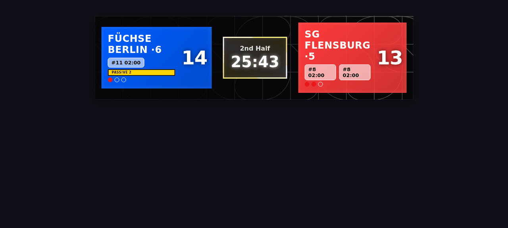
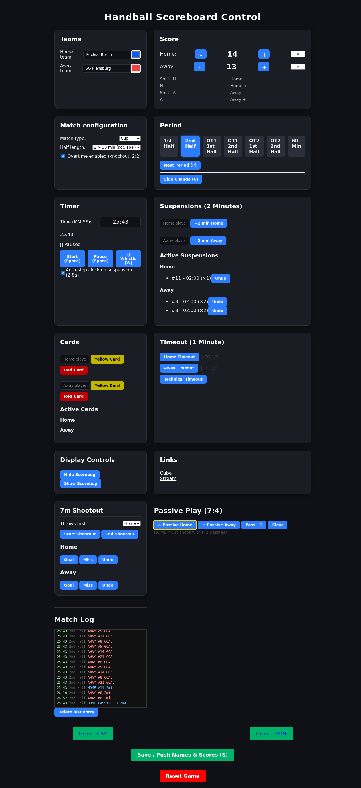
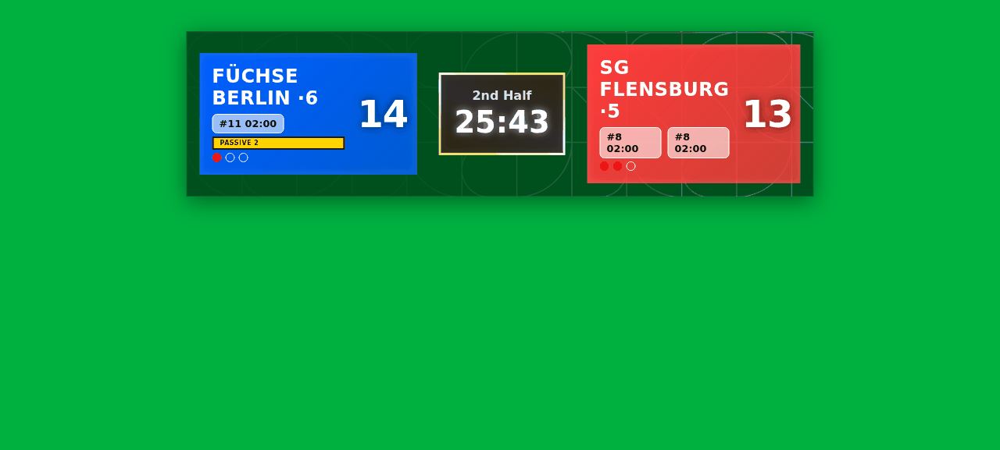

# handball_scorebug

A handball scoreboard (scorebug) for live video streams, designed for
chroma-keying: a transparent overlay on `/display`, operated from a
control panel on `/`.

<p>
  
</p>
<p>
  
  
</p>

The rules encoded here follow the official IHF *Rules of the Game* —
copies and a scorebug-relevant digest live in [`ref/`](ref/)
([`ref/RULES.md`](ref/RULES.md)). Core doctrine: the app **computes,
suggests, marks and warns, but the operator drives** — it never
whistles itself.

## Features

- **Broadcast overlay** (`/display`, transparent background) and a
  **cube variant** (`/cube`), both pushed live via WebSocket
- **Score + scorer numbers** — optional `#` per goal, `GOAL #23` flash
  on the overlay, goals-per-player in the export
- **Game clock** with drift-free updates, referee-whistle stop (2:8),
  auto-stop on suspension announcements
- **Match configuration** — match type, youth half lengths (2×30/2×25/
  2×20, 2:1), overtime on/off
- **Period logic** — overtime structure with the correct side-change
  rules (coin toss before each OT period, R10 Comment) and automatic
  break timers (10-minute half-time, 5 min before OT, 1 min between OT
  halves)
- **Suspensions** ticking on the game clock (2:8), automatic disqualification
  marking on a player's 3rd suspension (16:5), reduced-players-on-court display
- **Cards**, **team time-outs** with official quota flags (3 per match,
  2 per half, none in OT — 2:4 Comment, shown as dots on the overlay),
  **technical time-out** with countdown
- **Passive play** indicator with the 4-pass counter (7:4 +
  Clarification 4)
- **7-meter shootout** with alternating-order hints and
  operator-confirmed winner (2:2 Comment)
- **Match log** — every event (goals, 2-min, cards, time-outs, passive
  signal, period changes, breaks) kept chronologically and **exported
  as CSV or JSON** (`/export/report.csv`, `/export/report.json`) with
  goals-per-player and full timeline
- Redis-backed persistent state, survives restarts

## Keyboard shortcuts (control panel)

| Key | Action |
|---|---|
| `Space` | Start / pause game clock |
| `H` / `Shift+H` | Home + / − goal |
| `A` / `Shift+A` | Away + / − goal |
| `W` | Referee whistle |
| `P` | Next period |
| `C` | Side change |
| `S` | Save / push names & scores |

## Run

With Docker (scorebug + Redis + Caddy):

```bash
docker compose up --build
```

### Requirements

- Python 3.10+
- Redis Server
- pip

### Setup (Python virtual environment)

```bash
python3 -m venv env
source env/bin/activate   # Linux / macOS
# On Windows: venv\Scripts\activate

pip install --upgrade pip
pip install -r requirements.txt
```

### Installing Redis

```bash
# Debian/Ubuntu
sudo apt update && sudo apt install redis-server
sudo systemctl enable --now redis-server

# Redhat/Fedora
sudo dnf install redis && sudo systemctl enable --now redis

# macOS (Homebrew)
brew install redis && brew services start redis
```

### Run the app

```bash
redis-server   # if not already running
python app/app.py
```

| URL | Screen |
|---|---|
| `http://localhost:5000/` | control panel |
| `http://localhost:5000/display` | transparent scorebug overlay (chroma-key source) |
| `http://localhost:5000/cube` | 3-D cube variant |
| `http://localhost:5000/export/report.csv` / `.json` | match report export |

## Tests

```bash
cd tests && python3 -m unittest discover .
```

## Roadmap

See [ROADMAP.md](ROADMAP.md).
